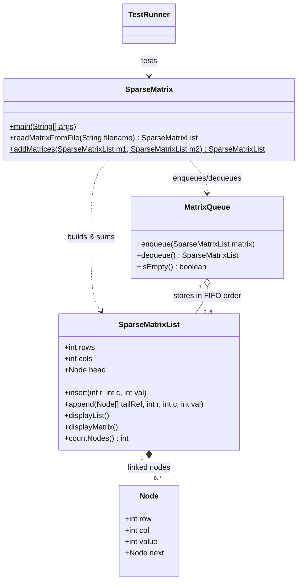

# Sparse Matrix Addition Engine (Custom LinkedList & Queue)


A high-efficiency Java engine designed to parse, queue, and sum large sparse matrices directly in memory without converting them into 2D arrays. Built from scratch using custom singly linked lists and a FIFO circular/array queue without relying on `java.util.LinkedList` or Java Collection frameworks.

---

## 🚀 Key Features
- **Custom Singly Linked List (`SparseMatrixList` & `Node`):** Stores only non-zero matrix elements ordered by ascending row and column coordinates, complete with $O(1)$ tail-pointer appending.
- **FIFO Processing Queue (`MatrixQueue`):** Buffers up to 6 parsed sparse matrices and processes sequential matrix additions in First-In, First-Out order.
- **Direct Linked-List Addition (`SparseMatrix`):** Uses a two-pointer simultaneous traversal algorithm to sum matrices directly in compressed form, automatically dropping zero-cancelled nodes (e.g., `5 + (-5) = 0`).
- **Custom Exception Hierarchy:** Enforces strict validation with four dedicated exceptions:
  - `MissingFileException` — Triggered when an input `.txt` file does not exist.
  - `InvalidFormatException` — Triggered on malformed dimensions, incomplete grids, or non-integer tokens.
  - `InconsistentDimensionException` — Triggered when attempting to sum matrices of differing `R x C` sizes.
  - `InvalidValueException` — Handles invalid matrix element values.
- **Automated Test Suite (`TestRunner`):** Self-contained test harness executing 10 normal, boundary, and error test cases with formatted console reporting.

---

## 🏗️ System Architecture (Class Diagram)


---

## ⚡ Algorithm Complexity Analysis

| Representation | Time Complexity (Adding $N$ Matrices) | Space Overhead ($1,000,000 \times 1,000,000$ Matrix) |
| :--- | :--- | :--- |
| **Custom Sparse Linked List** | $\mathcal{O}(N \times L)$ | Stores only $L$ non-zero nodes (a few KB) |
| **Traditional 2D Array (`int[][]`)** | $\mathcal{O}(N \times R \times C)$ | Requires $10^{12}$ cells (impossible in standard RAM) |

*Where $N$ = number of input matrices, $L$ = total non-zero elements, and $R, C$ = rows and columns.*

By using simultaneous two-pointer traversal over sorted linked nodes, the addition algorithm visits only meaningful non-zero coordinates, completely bypassing empty zeroes. See [`TimeComplexity.txt`](./TimeComplexity.txt) for the full breakdown.

---

## 💻 How to Run

### 1. Compile the Source Code
```bash
javac *.java
```

### 2. Mode A: Run the CLI Calculator (Up to 6 Matrices)
Pass between 1 and 6 matrix files via command-line arguments:
```bash
java SparseMatrix matrix1.txt matrix2.txt matrix3.txt matrix4.txt matrix5.txt matrix6.txt
```

### 3. Mode B: Run the Automated Test Suite (10 Test Cases)
Execute the built-in test runner, which pulls test matrices from the `testcases/` directory:
```bash
java TestRunner
```

---

## 🧪 Automated Test Suite Coverage (`TestRunner.java`)
1. **Test 1:** Normal Matrix Addition (`matrix1.txt`, `matrix2.txt`)
2. **Test 2:** Maximum Capacity Addition — 6 Matrices (`matrix1.txt` -> `matrix6.txt`)
3. **Test 3:** All-Zeros Matrix Handling (`matrix3.txt`)
4. **Test 4:** Negative Values Handling (`matrix4.txt`)
5. **Test 5:** Zero Cancellation Addition — `5 + (-5) = 0` (`matrix1.txt`, `matrix5.txt`)
6. **Test 6:** Very Sparse Structure Check (`matrix6.txt`)
7. **Test 7:** Boundary — Inconsistent Dimensions (`InconsistentDimensionException`)
8. **Test 8:** Boundary — Invalid File Format (`InvalidFormatException`)
9. **Test 9:** Boundary — Missing File (`MissingFileException`)
10. **Test 10:** Single Matrix Input (`N = 1`)

---

## 🖥️ Sample Test Runner Output
```text
=================================================================
|              SPARSE MATRIX AUTOMATED TEST SUITE               |
=================================================================

>> TEST 1: Normal Matrix Addition
  |-- Inputs  : matrix1.txt, matrix2.txt
  |-- Matrix 1 List  : 1 6 2 3 4 5 9 
  |-- Matrix 2 List  : 1 1 2 3 4 10 33 
  |-- Result List    : 1 2 6 5 3 14 5 42 
  \-- Status  : [ PASS ]
-------------------------------------------------------------------
...
=================================================================
| TEST RUN COMPLETE                                             |
| 10 Passed | 0 Failed                                          |
=================================================================
```

## 👤 Author
Subrota Debnath<br>
Master of Information Sciences<br>
Massey University
